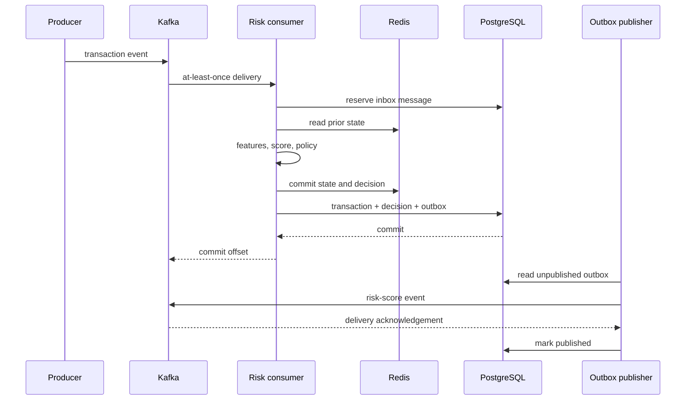
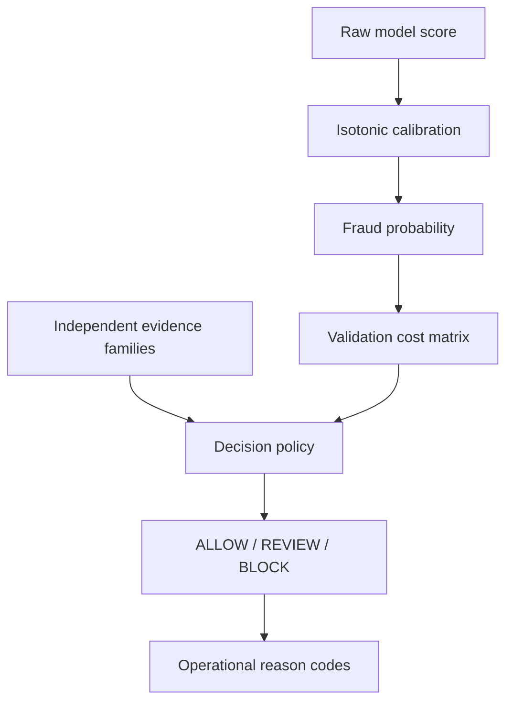

# Architecture Deep Dive

## Design objective

The platform must produce a low-latency decision while maintaining a durable, auditable record and ensuring that every historical feature represents only information available when the event occurred.

## Component responsibilities

| Component | Responsibility | Failure behavior |
| --- | --- | --- |
| Kafka | Durable transaction and decision event transport | Consumer resumes from committed offsets |
| Redis | Shared online histories, counters, idempotent decisions, rate limits | API readiness fails; scoring fails closed |
| Feature engine | Point-in-time velocity, novelty, amount and geography signals | Invalid/out-of-order events are rejected |
| XGBoost + calibrator | Ranking and calibrated probability | Artifact load failure makes API unready |
| Decision policy | Economic thresholds and evidence requirements | Ambiguous high scores route to review |
| PostgreSQL | Transaction, decision, case, label and governance ledger | Consumer transaction rolls back |
| Transactional outbox | Reliable downstream publication | Unpublished rows remain retryable |
| FastAPI | Authenticated synchronous scoring | Returns explicit 4xx/5xx responses |
| Streamlit | Analyst queue and system visibility | Read-only failure does not affect scoring |
| MLflow | Experiment and monitoring metadata | Telemetry failure does not erase PG record |

## Event processing sequence

The inbox prevents the same Kafka message from being applied twice. Transaction ID is the business idempotency key. The database transaction atomically stores the input, decision, investigation case when applicable, and outbound event.

## Point-in-time feature families

| Family | Examples | Leakage protection |
| --- | --- | --- |
| Amount | amount, typical-amount ratio, income ratio | Profile fixed before transaction generation |
| Customer velocity | count and sum over 10m, 1h and 24h | Windows exclude current event |
| Device novelty | customer-device prior uses, global device uses | Prior counters read before commit |
| Merchant novelty | customer-merchant prior uses | Prior counter read before commit |
| Geography | home distance, prior-event distance, travel speed | Previous event only |
| Merchant velocity | prior 1h/24h merchant counts and ratio | Merchant queue excludes current event |
| Calendar | hour, weekday, weekend, night | Derived from event timestamp |

Offline batch construction and online incremental construction implement the same feature names and semantics. `validate_feature_parity` replays historical events in time order and compares both outputs at `1e-6` tolerance.

## Modeling and policy boundary

The model ranks risk. Calibration makes the output more useful as a probability. Policy then combines that probability with evidence requirements and business economics. This avoids encoding every operational decision inside the classifier.

## Data consistency guarantees

- Kafka delivery: at least once.
- Inbox: one application per Kafka message ID.
- Transaction ledger: one record per transaction ID.
- Redis: atomic read/calculate/commit guarded by a distributed lock.
- API replay: returns the original decision and does not mutate state.
- Outbox: publication retries until Kafka acknowledges delivery.
- Test split: frozen and excluded from calibration and threshold selection.

The architecture intentionally does not claim global exactly-once processing across independent systems.

## Security boundary

- Protected routes use constant-time API-key comparison.
- Scoring limits are stored in Redis and shared across workers.
- Request correlation IDs are accepted or generated and returned.
- Logs exclude bodies, identifiers, feature snapshots, and keys.
- Production mode disables interactive API documentation.
- API container runs as a non-root user.
- Readiness verifies the model, Redis, and PostgreSQL.

## Scaling path

The portfolio system prioritizes correctness and auditability. A higher-volume evolution would:

1. partition Kafka and online state by customer ID;
2. replace the global Redis scoring lock with partition-local ownership or Lua transactions;
3. place the API behind a TLS gateway with workload identity;
4. operate PostgreSQL with managed replication and point-in-time recovery;
5. export OpenTelemetry traces and Prometheus metrics;
6. store model artifacts in a governed remote registry;
7. deploy separate consumer and API autoscaling policies.
