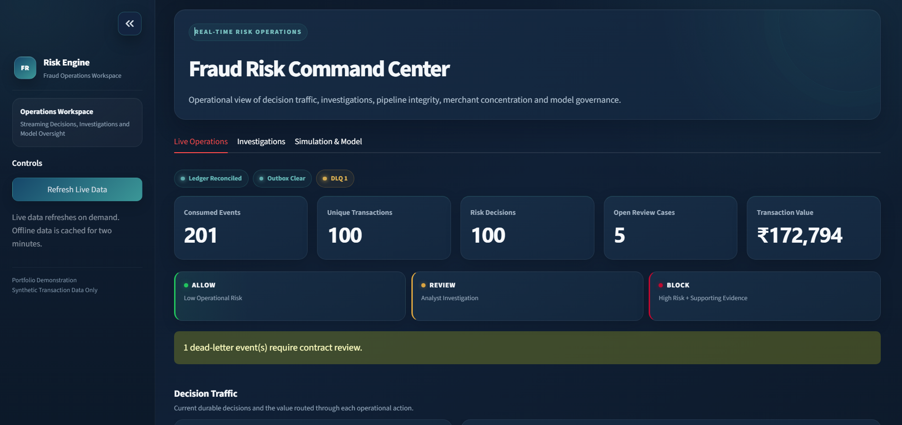
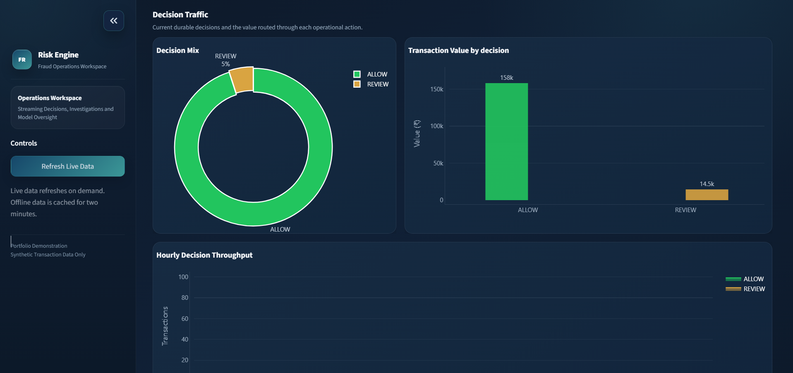
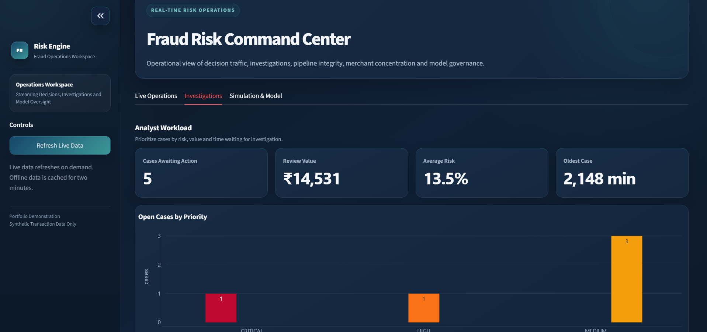
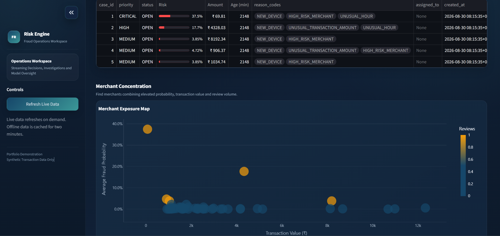
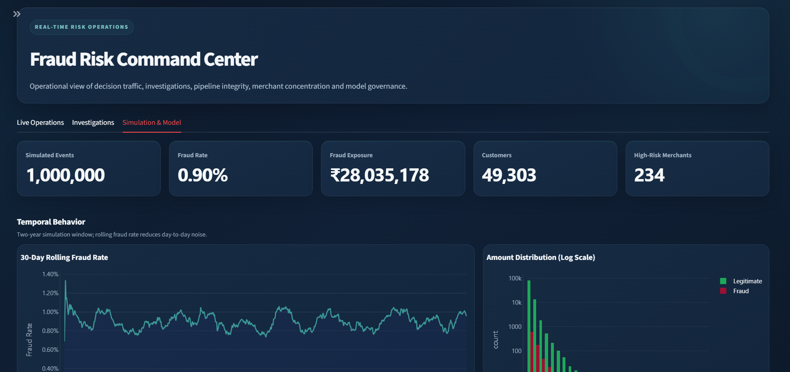
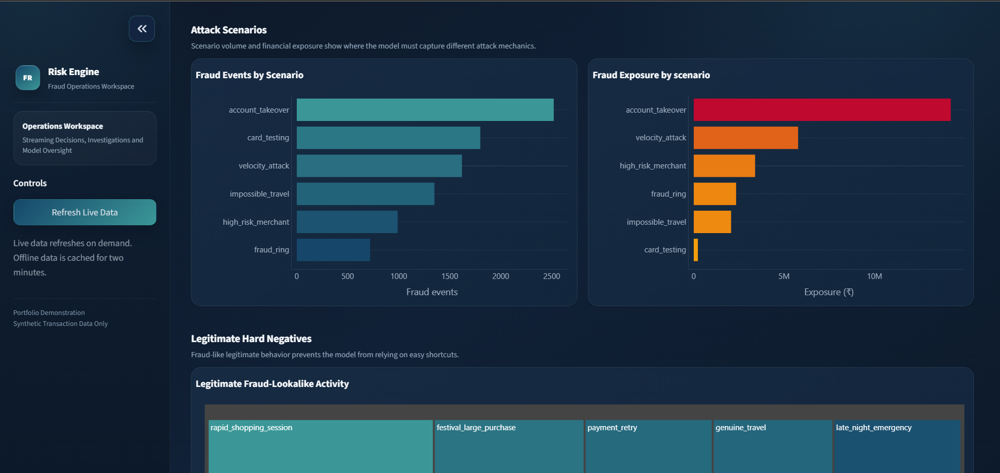
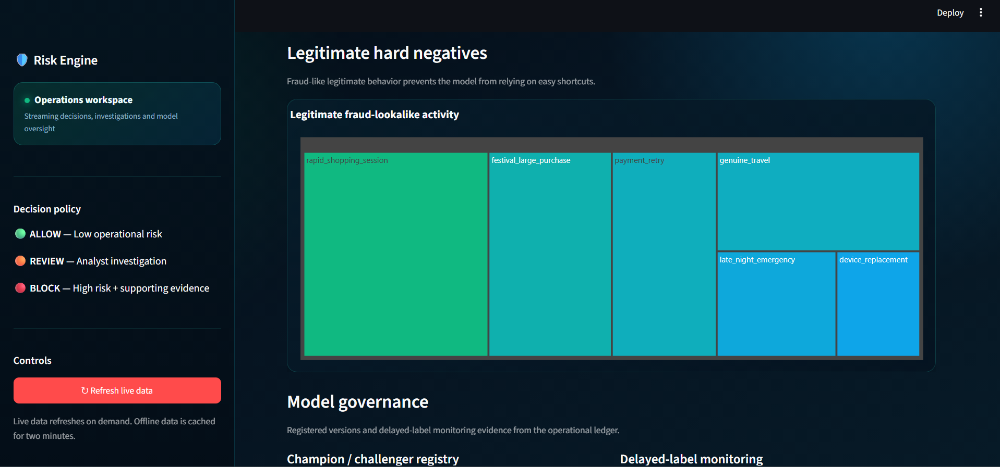

# Dashboard Gallery

These screenshots were captured from the working local fraud-risk environment using synthetic data.

## Live operations overview

## Decision traffic

## Investigation workload

## Merchant exposure

## Simulation trends

## Attack scenarios

## Hard negatives and governance

The screenshots intentionally show a dead-letter alert and open review cases. Those are operational evidence that the monitoring and investigation paths are active, not presentation defects.
